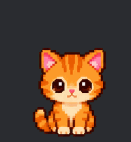

# Mascotte Chat



Un chaton roux qui vit sur le bureau de Windows : il respire, cligne des yeux, se promène le long du bas de l'écran, joue, miaule quand on clique dessus et fait de longues siestes.

*A little ginger kitten that lives on your Windows desktop: it idles, blinks, walks along the bottom of the screen, plays, meows when you click it, and takes long naps. Single exe, no install.*

## Installer

Télécharger `MascotteChat.exe` dans les [Releases](../../releases) et le lancer. Windows 10 ou 11, rien d'autre à installer.

L'exe n'est pas signé : Windows peut afficher « Windows a protégé votre ordinateur ». Cliquer sur *Informations complémentaires* puis *Exécuter quand même*.

## Ce qu'il fait

| | |
| --- | --- |
| **Tout seul** | il respire, cligne des yeux, salue de la patte, saute, se promène, et s'endort de temps en temps |
| **Clic** | il miaule (« Miaou ! », « Mrrr… », « Prrrr »…) et saute une fois sur trois |
| **Survol** | une petite barre apparaît sous lui : *caresser* et *menu* |
| **Glisser** | il court dans le sens où on le tire et garde sa nouvelle place |
| **Clic droit** | animations, taille (petite à très grande), balade, premier plan, lancement au démarrage de Windows, quitter |

On peut aussi le piloter depuis la ligne de commande :

```
MascotteChat.exe --etat waving
MascotteChat.exe --etat sleep
MascotteChat.exe --etat walking
```

## Changer son apparence

Un fichier `mascotte.png` posé à côté de l'exe remplace les images intégrées. C'est un atlas de 8 colonnes × 9 lignes, en cases de 192 × 208 pixels, fond transparent (repos, marche à droite, marche à gauche, salut, saut, raté, attente, jeu, sieste).

## Compiler

```
powershell -ExecutionPolicy Bypass -File construire.ps1
```

Le script utilise le compilateur C# livré avec Windows (.NET Framework 4). Python avec Pillow et numpy ne sert qu'à reconstruire l'atlas.

- `src/Mascotte.cs` : l'application (WPF, fenêtre transparente toujours visible).
- `personnages/chat/` : sa fiche (`perso.txt`), sa planche de 12 poses sur fond vert (`planche.png`, et `planche-retouche.png` pour les deux poses de salut redessinées), et l'atlas qui en est tiré.
- `outils/construire_atlas.py` : découpe la planche, retire le fond vert, fabrique les images de respiration, de saut et de marche, puis assemble l'atlas et l'icône.

Les poses ont été générées par IA à partir d'une description du chaton. Le moteur vient de [Mascotte Claude](https://github.com/Minecraft-2048/mascotte-claude).

## Licence

MIT, voir [LICENSE](LICENSE).
